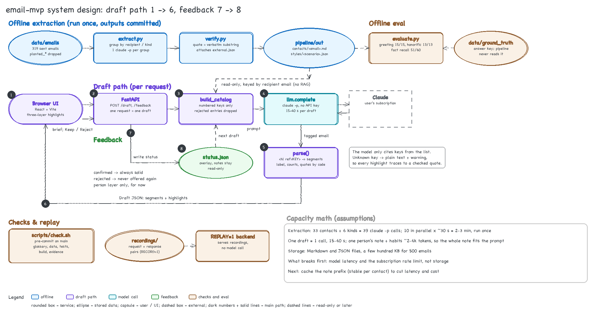
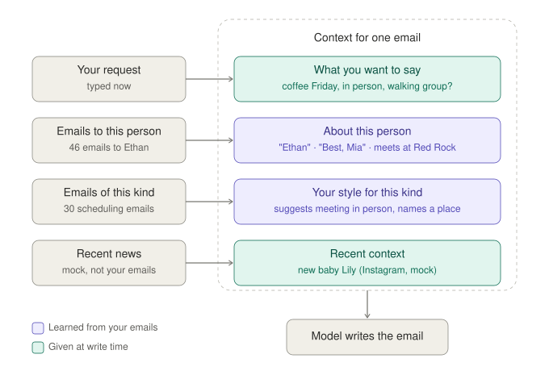
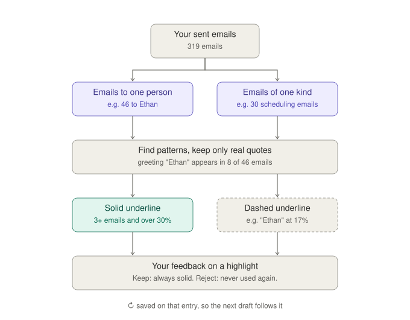

# email-mvp

Explainable personalized email drafting. Drafts are written for the relationship you have with each recipient
(how you address them, whether you use honorifics, what you both know), with your general style for the
scenario as a fallback. Every phrase that draws on a contact note, a scenario style or external context is
highlighted; hovering shows why, and opening it shows the original sentence from your past emails.

## System design



**Draft path (1 to 6).** The browser UI sends your request to FastAPI (1, 2). `build_catalog` looks up this
recipient's contact note and the scenario style by email, drops rejected entries and gives each remaining entry a
key (3). `llm.complete` calls the local `claude` command line (4). `parse()` turns the `<hl ref=KEY>` tags into
segments and highlights, and fills in each highlight's label, counts and quotes from the files (5). The draft goes
back to the UI (6).

**Feedback (7 to 8).** Keep and Reject go to `POST /feedback` (7), which writes the entry's status to
`backend/state/status.json` (8). The contact notes themselves stay read-only; the next draft reads the overlay.

**Offline.** `extract.py` and `verify.py` run once and their outputs in `pipeline/out/` are committed, so drafting
never re-extracts. `evaluate.py` scores those outputs against an answer key the pipeline never reads.
`scripts/check.sh` runs on every commit to `main`, and `REPLAY=1` serves recorded cases without calling the model.

## How the context is built

When you ask for a draft, the model gets four things: what you want to say, what you know about this person,
how you usually write this kind of email, and recent news about the person. The middle two are learned offline
from the emails you sent; every entry carries a verbatim quote that code has checked. The model only chooses which
entry to use; the reason, the counts and the quotes shown on each highlight come from the files, not from the model.



### Inputs

The examples below use one contact, Ethan Park (a pseudonym). His external context is mock.

| Input | Where it lives | Example | What it is used for |
| --- | --- | --- | --- |
| Sent emails | `data/emails/*.jsonl`, one email per line | `{"message_id": "syn-friend_scheduling-004-m1", "to": "ethan.park@example.com", "category": "friend_scheduling", "body": "Hi Ethan,\n\nHappy New Year! I would love to connect. Do you have time Wednesday afternoon\nor Friday after 1:00 PM?\n\nBest,\nMia"}` | The only source for the offline pipeline. Evaluation-only fields (`planted_*`) are dropped on load. |
| External context (mock) | `data/external.json`, grouped by recipient email | `{"id": "ext-ethan-3", "mock": true, "date": "2026-10-19", "source_label": "Ethan's Instagram (mock)", "text": "Ethan shared the first photo of his newborn daughter Lily ..."}` (the text is Chinese in the data; translated here) | Recent events about the recipient that are not in your emails. All items are mock; nothing is fetched. |
| Your request | `POST /draft` body | `{"mode": "compose", "to": "ethan.park@example.com", "brief": "Grab coffee with Ethan Friday afternoon. Ask if we can meet in person, Red Rock is fine. Also ask if his Saturday morning walking group is still taking people, and congratulate him on the new baby."}` | What you want to say. It may be in a different language from the email. |
| Your feedback | `POST /feedback`, stored in `backend/state/status.json` | `{"ethan.park@example.com": {"fact:f5": "rejected"}}` | Keep marks an entry `confirmed` (always drawn solid). Reject marks it `rejected` (never offered to the model again). Only person-layer entries are stored today. |

### What the offline pipeline produces

**Layer 1: scenario style.** How you usually write one kind of email, whoever it goes to. Each scenario has 4 to 8
habits a writer could copy. There are six scenarios: `friend_scheduling`, `old_friend_catchup`, `zh_en_casual`,
`zh_formal`, `vendor_service`, `refund_complaint`. Ethan's emails are all `friend_scheduling`.

```json
{
  "scenario": "friend_scheduling",
  "habits": [
    {
      "id": "prefers_in_person_suggests_place",
      "description": "Pushes to meet offline or in person and names a specific coffee or tea spot as a question.",
      "count": 6, "total": 30,
      "evidence": [{ "message_id": "19a42551a63d1540", "quote": "Any way we could meet offline?" }]
    }
  ]
}
```

**Layer 2: contact note.** How you write to one person and what you know about them. When the two layers
disagree, the contact note wins; whatever the note leaves empty falls back to the scenario style.

```yaml
email: ethan.park@example.com
display_name: Ethan Park
relationship: coach
address_as: { value: Ethan,     count: 8, total: 46, evidence: [{ quote: "Hi Ethan," }] }
sign_off:   { value: Best, Mia, count: 8, total: 46, evidence: [{ quote: "Best," }] }
language:   { value: en,        count: 8, total: 46 }
facts:
  - { id: f5, text: Red Rock coffee is their usual meeting place.,   evidence: [{ quote: "see you tomorrow at Red Rock!" }] }
  - { id: f8, text: Mia would rather meet in person than online.,    evidence: [{ quote: "Are you available to meet offline?" }] }
external: [{ id: ext-ethan-1, source_label: "Ethan's X (mock)" }, { id: ext-ethan-3, source_label: "Ethan's Instagram (mock)" }]
```

Every quote above is checked by `pipeline/verify.py`: it must be a verbatim substring of the cited email's body,
and that email must have gone to this contact. Unverified quotes are dropped, and an entry with no quote left is
dropped too. Notes also hold `address_as_by_context`, `honorific`, `edges` and `core_connection` when the emails
support them; Ethan's note has no honorific because the emails are in English.

### How a preference becomes solid or dashed



**Strength** (solid or dashed underline) is decided by code: an entry is `strong` when at least 3 emails support
it and they are more than 30% of your emails in that group (with no total, only the count of 3 applies). Ethan's
greeting appears in 8 of 46 emails (17%), so it is drawn dashed. External context is always `weak`, because it
has one source and does not come from your emails. An entry you confirmed with Keep is always `strong`.

### What the model sees when drafting

For one request, `backend/app/generator.py` gives the model:

1. **The recipient** (name and email) and **your request**.
2. **The scenario name**, for example `Scenario: friend_scheduling`. Today it is the most common scenario of your
   emails to this recipient, not a judgement about this email.
3. **A numbered list of notes**, each with a key the model must cite:
   - person layer: `address_as`, `address_as:<context>`, `honorific`, `sign_off`, `language`, `fact:<id>`
   - scenario layer: `habit:<id>` for each habit of that scenario
   - external layer: `external:<id>` for each recent item about the recipient
4. **Rules**: person notes override scenario habits; write in the recipient's language from the note, whatever
   the language of the request; wrap every phrase that uses a note in `<hl ref="KEY">…</hl>`; use only listed keys.

Rejected entries are left out of the list. The raw past emails are never shown to the model, only the verified
notes, so the model cannot cite a source that is not in the files.

### What comes back

The backend parses the tags into plain-text segments and highlights. For each highlight, the label, counts,
rationale, quotes and strength are filled in by code from the cited note. If the model cites a key that does not
exist, that text is shown without a highlight and a warning is returned.

```json
{
  "subject": "Coffee Friday afternoon? + congrats on Lily!",
  "segments": [{ "text": "Hi Ethan,", "highlight_id": "h1" }, { "text": "\n\n" }, "..."],
  "highlights": [
    {
      "id": "h1", "layer": "scenario", "ref": { "kind": "habit", "id": "casual_first_name_greeting" },
      "label": "Longer emails open with 'Hey <Name>' or 'Hi <Name>,' on its own line ...",
      "count": 9, "total": 30, "strength": "weak",
      "rationale": "In your friend_scheduling emails, 9 of 30 do this.",
      "evidence": [{ "message_id": "19a7f9b541476f30", "quote": "Hey Ethan" }]
    }
  ],
  "warnings": []
}
```

### Extracted but not used in drafting yet

| What | Where | Status |
| --- | --- | --- |
| Relationship edges (spouse, former student, ...) | contact note `edges` | Not passed to the model; the next step is to link them into a graph across contacts. |
| Core connection | contact note `core_connection` | Not passed to the model. |
| Relationship type (coach, advisor, hotel) | contact note `relationship` | Shown in the recipient picker only. |
| The previous email in a thread | `prev` field of each email | Reply mode is a stub; the previous email is not in the prompt yet. |
| Feedback on scenario habits | — | Keep and Reject change the underline only; they are not stored. |

## Evaluation

`pipeline/evaluate.py` compares the contact notes with a hand-written answer key (`data/ground_truth/people.json`,
which the pipeline never reads): greeting 15/15, honorific 13/13, fact recall 51/60 (85%). The prompts were tuned
against this same answer key, so the fact-recall number has not been validated on held-out data.

## Run it

From the repository root, in separate terminals:

```bash
cd backend && python3 -m venv .venv && .venv/bin/pip install -r requirements.txt
cd backend && RECORD=0 .venv/bin/uvicorn app.main:app --port 8041
cd frontend && npm ci && VITE_API_BASE=http://localhost:8041 npx vite --port 5181
```

Drafting calls the local `claude` command line. `RECORD=0` stops the backend from writing request and response
pairs to `recordings/`; `REPLAY=1` serves those recordings without calling the model. Data locations can be
changed with `EMAILS_DIR`, `CONTACTS_DIR`, `STYLES_DIR`, `EXTERNAL_FILE` and `STATUS_FILE`. To rebuild the
profile files, see `pipeline/README.md`. To run every check: `scripts/check.sh`.
